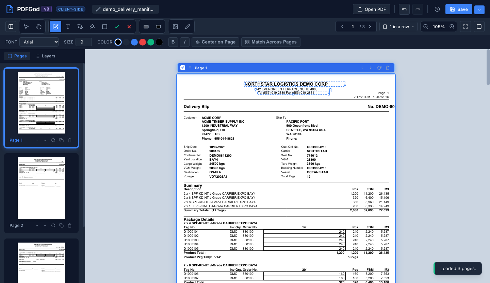
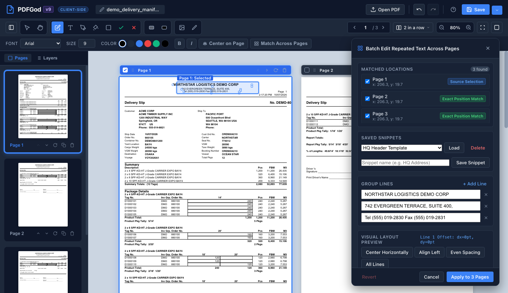
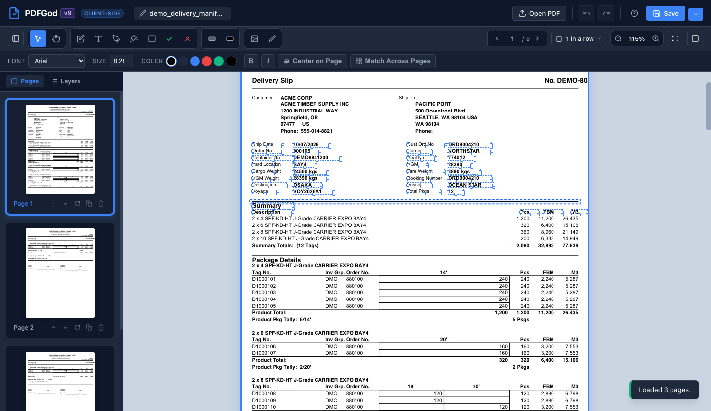
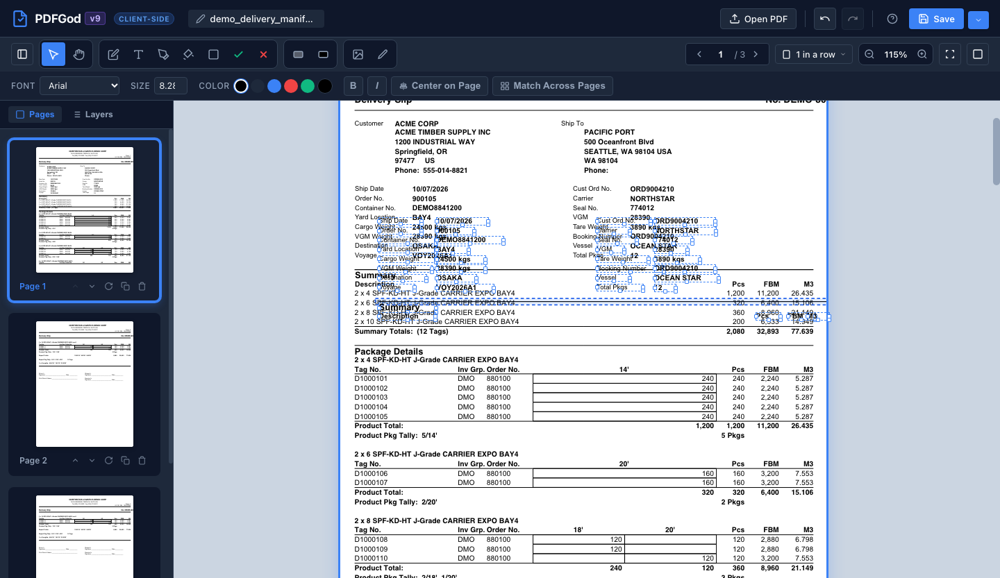
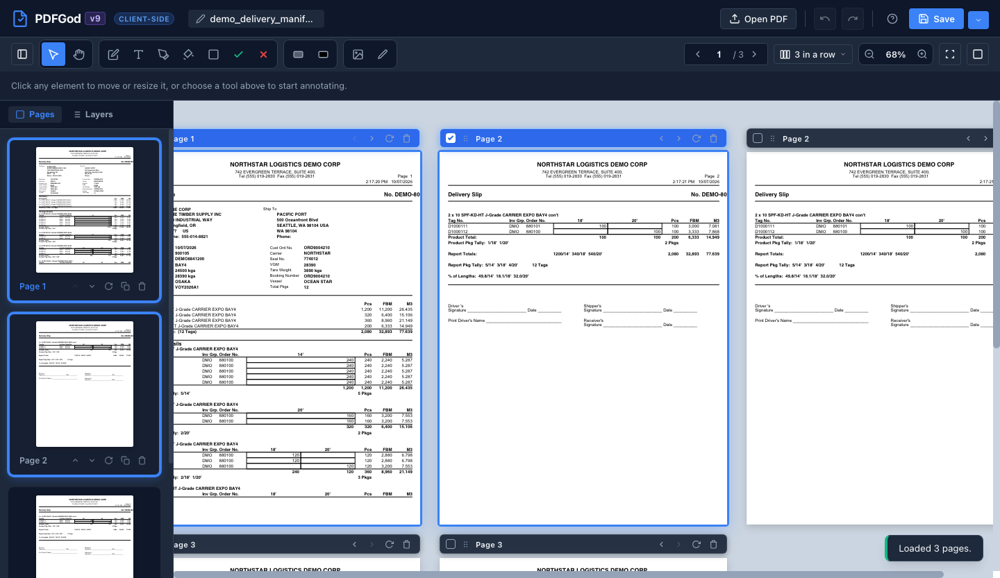
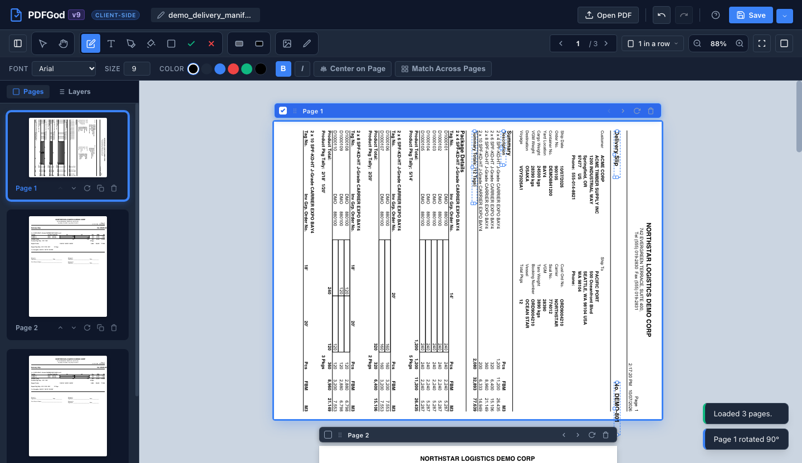
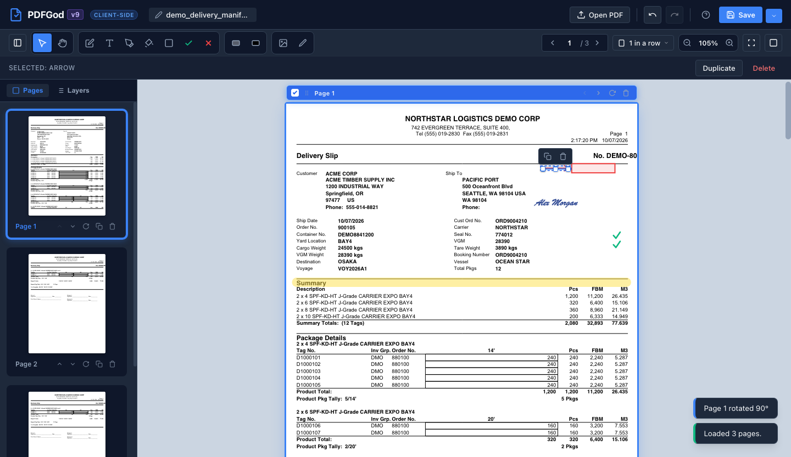
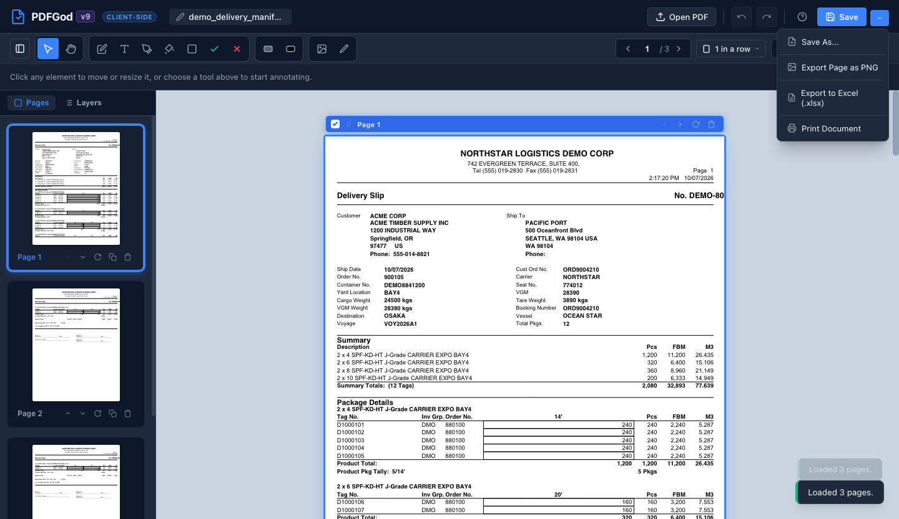

# 📄 PDFGod v9 — In-Browser PDF Editor (Single-File Web App)

[-chayneps.github.io%2Fpdfgod-2563eb?style=for-the-badge&logo=googlechrome&logoColor=white)](https://chayneps.github.io/pdfgod/pdfgod.html)
[](https://chayneps.github.io/pdfgod/pdfgod.html)
[](https://chayneps.github.io/pdfgod/pdfgod_v8.html)
[](https://opensource.org/licenses/MIT)

> ### 🌐 Two Ways to Use PDFGod:
> 1. **Run Instantly Online**: Click **[https://chayneps.github.io/pdfgod/pdfgod.html](https://chayneps.github.io/pdfgod/pdfgod.html)** to launch the app immediately in your browser.
> 2. **Download & Run Offline**: Download the latest **[`pdfgod.html`](https://raw.githubusercontent.com/chayneps/pdfgod/main/pdfgod.html)** (or from the repository root) and double-click it to open in any modern web browser — 100% self-contained single file with zero installations, zero extensions, and zero dependencies!

A fast, private, and full-featured client-side web application to edit, annotate, sign, redact, and manipulate PDF documents directly in the browser.

> **📦 100% Self-Contained Single File**: The entire application (all UI, CSS, icons, PDF.js, PDF-Lib, and Web Worker) is embedded into **`pdfgod.html`**. You can open it offline, transfer it anywhere, or host it statically with zero build steps and zero dependencies! Previous versions are archived alongside the latest build (e.g. `pdfgod_v8.html`, `pdfgod_v7.html`, `pdfgod_v6.html`, `pdfgod_v5.html`, `pdfgod_v4.html`).

---

## 📸 Visual Feature Tour

### 1. In-Place PDF Text Editing & Center on Page
Click any original PDF text in **Edit PDF Text** mode to convert it instantly into an editable text box. Select multiple text elements and click **Center on Page** in the Text Properties Bar to automatically center them based on their exact rendered width.



---

### 2. Match Across Pages, Visual Layout Preview & Saved Snippets
Select recurring header lines or disclaimers and click **Match Across Pages** to scan the entire document. The interactive **Visual Layout Preview** stage lets you adjust per-line relative spacing, alignments, and typography, or save reusable templates to LocalStorage for one-click re-use.



---

### 3. Marquee Rectangle Selection (Text & Vector Lines)
Click and drag across empty page canvas in **Select** tool mode to select text blocks and vector table lines simultaneously. Accelerated by a 2D spatial hash grid (`SpatialGrid2D`) and unified single-pass token stream redaction for instantaneous sub-millisecond selection of hundreds of items.



---

### 4. Group Duplicate (<kbd>Ctrl+C</kbd> $\rightarrow$ <kbd>Ctrl+V</kbd>) & Arrow Key Movement
Duplicate selected groups of text and vector lines while preserving their exact relative positions, typography, and styling. Use the **Arrow keys** to move the entire group by `5px` ("a bit big move") or **<kbd>Shift</kbd> + Arrow keys** for `1px` pixel-perfect micro-nudging.



---

### 5. Multi-Column Views (3 in a Row) & Multi-Page Range Selection
Seamlessly switch between **1 in a row**, **2 in a row**, and **3 in a row** overview layouts. Click and **<kbd>Shift</kbd> + Click** to select contiguous page ranges with visual blue glowing selection rings and header checkboxes (`☑`) for bulk dragging, cloning, or deletion.



---

### 6. Synchronized 90° Page & Annotation Rotation
Rotating any page 90° clockwise rotates all existing annotations on that page in exact 90° lockstep — including converted original PDF text, user text boxes, vector lines, geometric shapes, and freehand drawings, with 100% fidelity in both the live DOM and exported PDF-Lib output.



---

### 7. Digital Signatures, Highlighter, Shapes & Checkmarks
Sign documents with authentic cursive signatures (Draw, Type, or Upload image), highlight passages with semi-transparent highlighter ink, place geometric shapes and directional arrows, and quickly approve form boxes with one-click checkmark stamps (`✓`).



---

### 8. Export to Excel (`.xlsx`) & Document Save Menu
Export entire multi-page PDFs to Excel workbooks with 100% text preservation and vector lines converted directly to thin cell borders. Quick-save directly to your existing file (<kbd>Ctrl+S</kbd>), save under a new name with **Save As...**, or export pages as high-resolution PNGs.



---

## ✨ Features & Capabilities

### 🔒 1. 100% Client-Side & Private
- All processing, rendering, and vector modifications happen strictly inside your browser using **HTML5 Canvas**, **PDF.js**, and **PDF-Lib**.
- Works completely **offline** without any internet connection.
- No documents, signatures, or confidential data ever leave your device.

### ✍️ 2. Comprehensive Editing & Annotation Tools
- **Marquee Rectangle Text & Vector Line Selection**:
  - Click and drag across empty page space in **Select**, **Edit PDF Text**, or **Text** tool modes to draw a live dashed selection box.
  - **Arrow Select Tool (`Select`)**: Selects both **vector lines** and **text** in groups (via click, `Shift+Click`, or marquee rectangle).
  - **Edit PDF Text Tool**: Selects **text only**, completely ignoring vector lines and shapes.
  - Automatically converts intersecting original PDF items into editable elements under a single undoable step.
  - **High-Performance Architecture (v8)**:
    - **2D Spatial Hash Grid (`SpatialGrid2D`)**: Accelerates intersection queries from $O(N)$ brute-force to $O(1)$ spatial bucket lookups for instant sub-millisecond selection of hundreds of items.
    - **Single-Pass Batch Stream Redaction (`redactItemsFromPage`)**: Replaces sequential $N$-pass PDF stream parsing with a unified single-pass token stream rewrite, delivering **~150x faster** high-volume group selection and conversion.
    - **Batched DOM Mounting**: Uses `DocumentFragment` batch mounting to eliminate DOM reflow bottlenecks when converting multiple text blocks.
    - **Synchronized Canvas Redraw**: Immediately redraws canvas overlays upon deselection, clicking outside, or multi-selection toggles so vector line selection highlights clear instantly and seamlessly.
  - **Synchronized Group Manipulation**: Selected lines and text can be moved together with **Arrow keys** (`5px` normal, `1px` with `Shift`) or mouse dragging, duplicated with <kbd>Ctrl+C</kbd> -> <kbd>Ctrl+V</kbd>, and deleted with <kbd>Delete</kbd> / <kbd>Backspace</kbd>.
  - Hold **<kbd>Shift</kbd>** while dragging or clicking to append additional items to the current selection.
- **Match Across Pages (Batch Group Editor, Visual Layout Preview & Saved Snippets)**:
  - Select one or multiple lines (e.g. company headers, addresses, or phone numbers) and click **Match Across Pages** in the Text Properties Bar.
  - Automatically detects matching spatial blocks across the entire document, with smart page detection (matches in the same position checked by default, out-of-zone matches unchecked).
  - **Visual Layout Preview Stage**: Interactive stage allowing per-line relative dragging, independent formatting (font family, size, weight, color), and group alignment (Keep, Left, Center on Page).
  - **Reusable Snippets**: Save customized header/text templates to browser storage (`localStorage`) and load them with one click into future documents or sessions.
  - **Single History Step & Atomic Revert**: Batch edits apply cleanly across all checked pages, with an instant **Revert Group** capability that fully restores the original PDF vector text and ink.
- **Text Insertion & Inline Editing**:
  - Click anywhere on any page to type and place text.
  - Choose from standard fonts (Helvetica, Times Roman, Courier, Arial, Georgia).
  - Configurable font size (8pt to 72pt), color swatches + custom color picker, bold (`B`), italic (`I`).
  - **Two-Stage Click on Text**:
    - **1st Click = Select Text Box**: Clicking any PDF text or text box selects the box as a whole (dashed blue outline) so **Left / Right / Up / Down Arrow keys** move the entire text box (`5px`, or `1px` with `Shift`).
    - **2nd Click = Edit Characters**: Clicking an already-selected text box a second time enters character-editing mode (solid blue outline) and places the caret at the clicked character so **Left / Right Arrow keys** navigate character-by-character.
  - **Center Text on Page (Using Actual Text Width)**: Click **Center on Page** in the Text Properties Bar to horizontally center selected text in the middle of the page based on the **actual rendered text width** (rather than the outer text box width).
  - **Clean & Unobtrusive Text Properties Bar**: Streamlined toolbar without redundant buttons; fast keyboard shortcuts handle duplication (<kbd>Ctrl+C</kbd> -> <kbd>Ctrl+V</kbd>) and group deletion (<kbd>Delete</kbd> / <kbd>Backspace</kbd>).
  - **Keyboard Arrow Key Nudging**: While selecting a text box, use the **Arrow keys (Up / Down / Left / Right)** to move the text box by **5px** ("a bit big move"), or hold **<kbd>Shift</kbd> + Arrow keys** for a **1px micro-move** for pixel-perfect line alignment without scrolling the page.
  - **Shift-Select & Move Together**: Hold **<kbd>Shift</kbd>** and click multiple text boxes to select a group. Once selected:
    - **Drag Together**: Dragging any selected text box or its border moves all selected boxes together in real time.
    - **Arrow Nudge Together**: Pressing **Arrow keys** nudges all selected boxes together by **5px**, and **<kbd>Shift</kbd> + Arrow keys** micro-nudges all of them together by **1px**.
  - **Copy & Paste (<kbd>Ctrl/Cmd+C</kbd> / <kbd>Ctrl/Cmd+V</kbd>)**:
    - Press **<kbd>Ctrl+C</kbd> / <kbd>Cmd+C</kbd>** to copy selected text box(es). If multiple text boxes are selected, it copies all of them.
    - Press **<kbd>Ctrl+V</kbd> / <kbd>Cmd+V</kbd>** to paste them onto the active page, preserving their exact relative positions, styling, and fonts.
    - Also copies plain text to the system clipboard for pasting into other apps.
  - **Click Outside to Unselect**: Click anywhere outside the text boxes (on empty page canvas, another page, or on the gray workspace background) to immediately unselect all selected text boxes and commit your edits cleanly without creating unwanted new text boxes.
  - **Group Actions**: Pressing <kbd>Delete</kbd> or <kbd>Backspace</kbd> deletes the entire selected group.
- **Digital Signatures**:
  - **Draw**: Natural, smooth signature pad with ink color options (Dark Slate, Navy Blue, Deep Red) and clear button.
  - **Type**: Type your name and choose from authentic cursive handwriting styles.
  - **Upload**: Import an existing signature image (PNG, JPG, SVG) with transparent background support.
- **Freehand Pen & Highlighter**:
  - Pressure-smooth freehand pen drawing with adjustable stroke width (1px to 16px) and color palette.
  - Semi-transparent highlighter brush (`multiply` blend mode) to mark important text without obscuring it.
- **Vector Shapes**:
  - Rectangles, Circles / Ellipses, Straight Lines, and Directional Arrows.
  - Customizable border colors, fill colors (transparent, white, light tints), stroke thickness, and opacity.
- **Form Filling Stamps**:
  - One-click Checkmarks (**✓**) and Crosses (**✗**) to quickly fill checkboxes and approval boxes on forms.
- **Redaction & Whiteout**:
  - **Whiteout**: Erase/cover unwanted text or errors cleanly with white fill.
  - **Blackout**: Redact confidential numbers, account IDs, or sensitive clauses with solid black bars.
- **Image & Stamp Placement**:
  - Upload logos, official stamps, badges, or diagram images and place them anywhere on the document.

### 📑 3. Page Organization & Multi-Column Viewing
- **Multi-Column Layout Views (1, 2, or 3 Pages in a Row)**:
  - Toggle between **1 in a row** (standard vertical reading), **2 in a row** (side-by-side spread), or **3 in a row** (multi-column overview) via the dropdown beside the page indicator or using shortcuts (<kbd>Alt+1</kbd>, <kbd>Alt+2</kbd>, <kbd>Alt+3</kbd>).
- **Click & Shift-Click Multi-Page Range Selection**:
  - Select individual pages or click and **<kbd>Shift</kbd> + click** to select a contiguous block of pages across the document or sidebar thumbnails.
  - Interactive checkboxes (`☑`) on each page header bar and synchronized glowing selection rings indicate selected pages.
  - **<kbd>Ctrl/Cmd</kbd> + click** toggles individual pages in or out of the selection.
- **Drag-and-Drop Page Rearranging**:
  - Drag any selected page header bar or thumbnail card to rearrange the entire selected range as a single block into any target position.
  - Dynamic drop insertion lines and tooltips provide real-time guidance (e.g. `Move 3 pages (Pages 1–3) to position 5`).
- **Drag-and-Drop External PDF Files**:
  - Drag one or more PDF files directly from your desktop or file manager into the document canvas or between thumbnail cards to insert pages at that exact location.
- **Sidebar Thumbnails**: Visual mini-previews of all pages with page numbers and quick actions.
- **Rotate, Duplicate, & Delete**:
  - Rotate 90° clockwise, clone, or delete single pages or entire multi-page selections in bulk.
  - **Synchronized Annotation & Vector Rotation (v9)**:
    - Rotating any page instantly rotates all existing annotations on that page in exact 90° lockstep.
    - Preserves exact relative positioning and orientation for converted original PDF text, user text boxes, vector lines, geometric shapes, and freehand drawings.
    - Applied both in the live interactive DOM overlay and when exporting with PDF-Lib for pixel-perfect exported PDF fidelity.
- **Add Blank Pages**: Insert clean white pages anywhere in the document.

### 💾 4. Save & Export
- **Export to Excel (`.xlsx`)**:
  - Converts every PDF page to its own worksheet in a standard `.xlsx` workbook.
  - **100% Text Preservation**: Retains all original PDF text plus any user annotations without dropping headers, footers, or table contents.
  - **Vector Cell Borders**: Extracts vector lines and rectangles from the PDF and converts them directly into matching thin cell borders in Excel.
  - **Visual Column Alignment**: Aligns text items belonging to the same visual column across data rows.
- **Save Document (`pdf-lib`)**:
  - Saves directly to the document file name specified in the top header.
  - Prompts for replacement confirmation if a file with that name exists, with the option to rename before saving.
  - Preserves original PDF text vectors, metadata, and layers while embedding all annotations, signatures, and drawings.
- **Save As...**:
  - Accessible via the dropdown menu right beside the Save button to save under a new file name.
- **Refresh & Navigation Protection (`beforeunload`)**:
  - Native browser confirmation prompt warns against accidental tab closures or refreshes when unsaved changes exist.
- **Export Page as Image**: Download current page as a 2x high-resolution PNG.
- **Print**: Direct browser print integration.

### ⌨️ 5. Undo / Redo & Keyboard Shortcuts
- Full undo/redo history stack (`Ctrl+Z` / `Ctrl+Y`).
- Interactive selection bounding box with 8 corner/edge resize handles and drag-to-move.
- Keyboard shortcuts for all major tools:

| Shortcut | Action |
| :--- | :--- |
| <kbd>V</kbd> | Select / Move / Resize Tool |
| <kbd>H</kbd> | Hand / Pan Viewport Tool |
| <kbd>T</kbd> | Add Text Tool |
| <kbd>Shift</kbd> + Click | Multi-Select / Toggle Multiple Elements (Text, Lines) |
| <kbd>Arrow Keys</kbd> | Nudge Selected Element(s) (Text, Lines) by 5px |
| <kbd>Shift</kbd> + <kbd>Arrow Keys</kbd> | Micro-Nudge Selected Element(s) (Text, Lines) by 1px |
| <kbd>P</kbd> | Freehand Pen Drawing |
| <kbd>Shift</kbd> + <kbd>H</kbd> | Highlighter Tool |
| <kbd>R</kbd> | Whiteout / Redaction Tool |
| <kbd>G</kbd> | Digital Signature Modal |
| <kbd>Del</kbd> / <kbd>Backspace</kbd> | Delete Selected Element(s) |
| <kbd>Ctrl</kbd> / <kbd>Cmd</kbd> + <kbd>C</kbd> | Copy Selected Element(s) |
| <kbd>Ctrl</kbd> / <kbd>Cmd</kbd> + <kbd>V</kbd> | Paste Copied Element(s) |
| <kbd>Ctrl</kbd> / <kbd>Cmd</kbd> + <kbd>D</kbd> | Duplicate Selected Element(s) |
| <kbd>Ctrl</kbd> / <kbd>Cmd</kbd> + <kbd>Z</kbd> | Undo |
| <kbd>Ctrl</kbd> / <kbd>Cmd</kbd> + <kbd>Y</kbd> | Redo |
| <kbd>Ctrl</kbd> / <kbd>Cmd</kbd> + <kbd>S</kbd> | Save PDF Document |
| <kbd>+</kbd> / <kbd>-</kbd> | Zoom In / Out |
| <kbd>?</kbd> | Show Keyboard Shortcuts Modal |

---

## 📁 Project Structure

```
keen-brahmagupta/
├── pdfgod.html             # Main single-page web app
├── server.js               # Zero-dependency local development HTTP server
├── package.json            # NPM scripts & configuration
├── css/
│   ├── main.css            # Base styles, color system, layout, reset, toasts
│   ├── toolbar.css         # Top toolbars, tool buttons, properties bar
│   ├── sidebar.css         # Left sidebar, thumbnail cards, layers list
│   ├── canvas.css          # Viewport, page render, annotation overlay, selection handles
│   └── modals.css          # Native <dialog> styles (Signature pad, shortcuts, save-as)
├── js/
│   ├── app.js              # Application coordinator & global shortcuts
│   ├── pdf-engine.js       # PDF.js rendering & PDF-Lib vector export
│   ├── annotation-manager.js # Annotation state store & undo/redo history
│   ├── canvas-controller.js# Drawing, shape drafting, text editing, dragging, resizing & arrow nudging
│   ├── signature-pad.js    # Signature modal (Draw, Type cursive, Upload)
│   └── ui-controller.js    # UI bindings, zoom, thumbnail sync, save/save-as modals
└── vendor/
    ├── pdf.min.js          # Mozilla PDF.js v3.11
    ├── pdf.worker.min.js   # PDF.js Web Worker
    └── pdf-lib.min.js      # PDF-Lib v1.17
```
